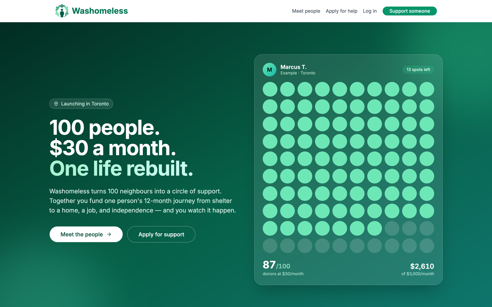
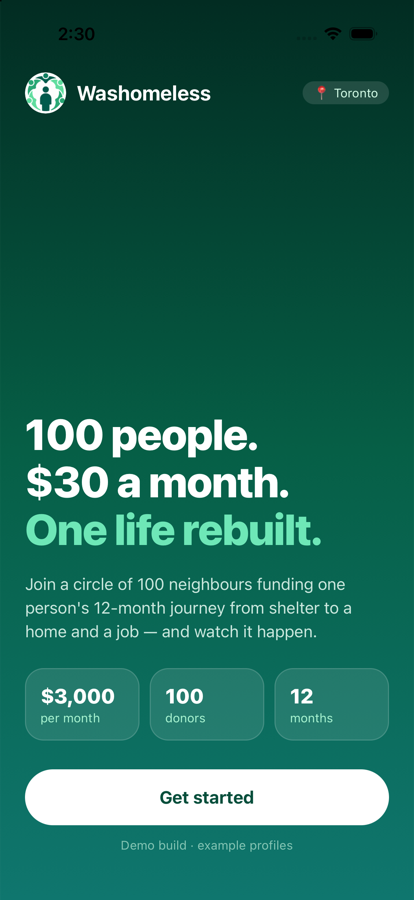
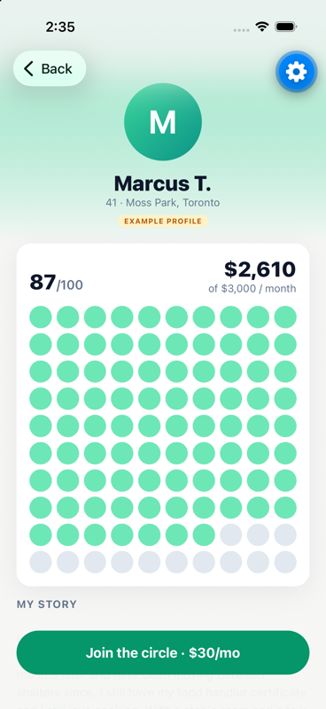

# Washomeless

**100 neighbours. $30 a month. One life rebuilt.**

Washomeless turns 100 donors into a circle of support for one person experiencing homelessness in Toronto. Each supporter gives $30/month, so together they fund $3,000/month for a 12-month journey from shelter to a home, a job and independence. Supporters follow along through short voice notes, photos and text updates the person posts from their phone.

🌐 **Live:** [washomeless.com](https://washomeless.com) · 📍 Toronto · Built for the Better Toronto Buildathon



<p>
  
  &nbsp;
  
</p>

## How it works

1. **Apply.** A person experiencing homelessness applies with their story. An admin reviews and approves it before anything is public.
2. **Join a circle.** Donors choose someone and give $30/month, up to 100 supporters per person.
3. **Follow the journey.** The person posts text, photo or voice updates (goal: 2 per week) and ticks off milestones: housing, health, training, steady income.

## Features

**Website (Next.js)**
- Landing page with the 100-donor circle, an example $3,000 monthly budget, the 12-month journey and an impact calculator
- Application flow with admin approval/rejection
- Text, photo and voice updates, recorded in the browser, with a weekly posting goal
- **Privacy by design:** full updates are visible only to the person's active supporters; everyone else sees a locked teaser (type, headline, date)
- Custom voice note player (waveform, seek, playback speed)
- Optional profile photos, with guidance to avoid showing faces for safety
- Stripe Checkout for $30/month subscriptions (payment code in place, not yet live)

**iOS app (Expo / React Native)**
- Discover people, view profiles, journeys and updates from the live database
- Login with the same account as the website
- **My Journey** tab that appears only for approved people: post voice notes, photos or text straight from the phone and change their profile photo
- Same privacy rules as the website; falls back to example profiles when offline

## Tech

| Layer | Tools |
|---|---|
| Web | Next.js 14 (App Router), TypeScript, Tailwind CSS, shadcn/ui, Vercel |
| Mobile | Expo SDK 58, Expo Router, expo-audio, expo-image-picker |
| Backend | Supabase: Postgres with row-level security, Auth, Storage (private media with signed URLs), RPC functions |
| Payments | Stripe |

Security highlights (see `supabase/migrations/`):
- Applicants can only create a *pending* application, once per account
- Approval upgrades the account to "sponsored" through a database trigger
- Updates and media are readable only by the owner, their active supporters and admins
- The public sees teasers through a `security definer` function that never exposes content
- People can change only their own photo, via a validated RPC

## Project structure

```
apps/web/        Next.js website (washomeless.com)
apps/mobile/     Expo iOS app
supabase/        Database migrations (schema, policies, functions)
marketing/       LinkedIn assets
```

## Run locally

**Website**
```bash
cp apps/web/.env.local.example apps/web/.env.local   # add Supabase + Stripe keys
npm install
npm run dev                                          # http://localhost:3000
```

**iOS app**
```bash
cd apps/mobile
cp .env.example .env.local                           # add Supabase URL + anon key
npm install
npx expo start --ios                                 # opens the iPhone simulator
```

**Database:** apply the SQL files in `supabase/migrations/` in order (`supabase db push`, or paste them into the Supabase SQL editor).

## Status

Working prototype. Example profiles on the site are illustrative and labelled "Example profile". Next steps: live payments, TestFlight build, push notifications for milestones, and partnering with Toronto shelters and caseworkers to refer and verify applicants.
